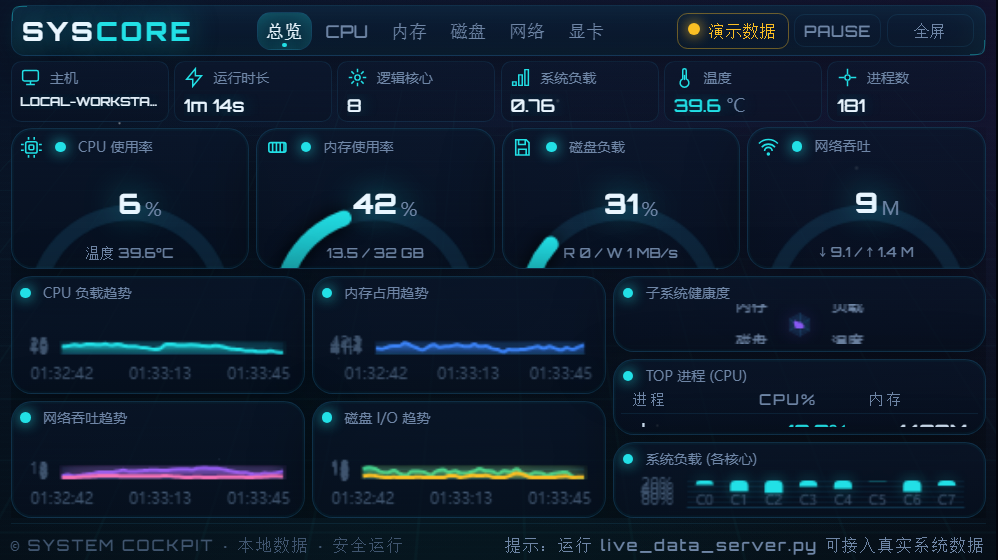
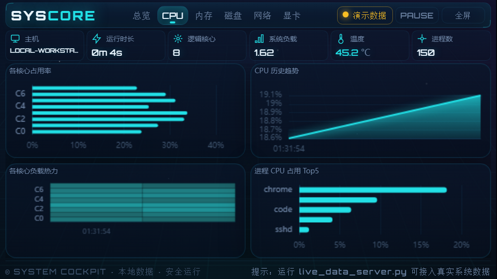
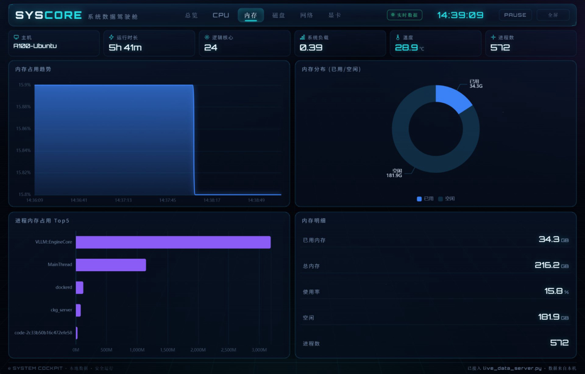
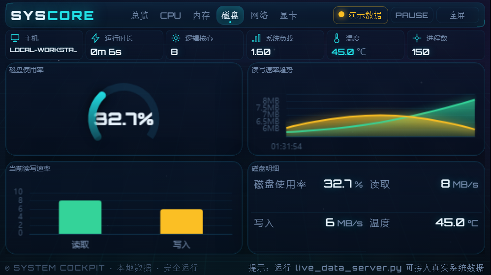
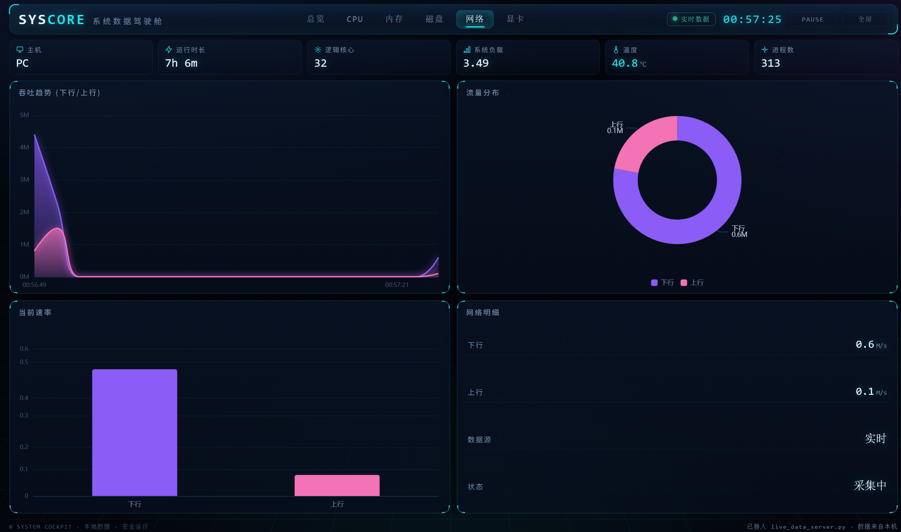
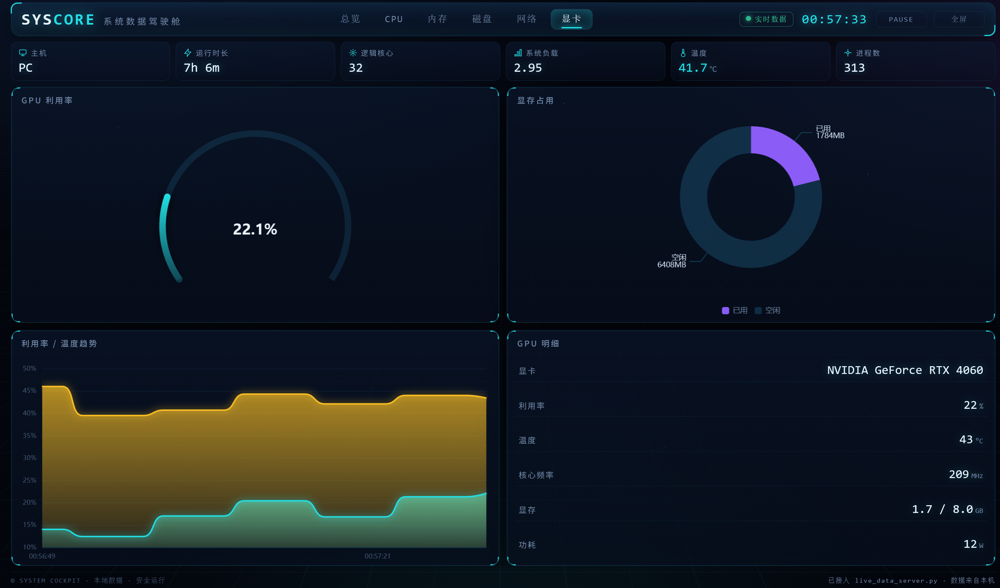

# System Cockpit · PC Performance Dashboard


A **pure front-end + lightweight local server** PC real-time performance monitoring dashboard. Single-screen overview plus five detail tabs (CPU / Memory / Disk / Network / GPU), visualized with ECharts.

- **Fully offline / intranet-ready** — all dependencies (ECharts, fonts) are bundled locally; no external network required.
- **Data never leaves your machine** — the backend binds to loopback `127.0.0.1` only.
- **Cross-platform** — runs on Windows / Linux / macOS.

## Screenshots



### More views

| | |
|---|---|
|  |  |
|  |  |
|  |  |

---

## Features

| Area | Content |
|------|---------|
| Overview | CPU / Memory / Disk / Network gauges + load trend + system-load radar + per-core usage + TOP processes |
| CPU | per-core usage, history trend, per-core load heatmap, top-5 processes by CPU |
| Memory | usage trend, used/free donut, top-5 processes by memory, memory details |
| Disk | usage gauge, read/write rate trend, current R/W bars, disk details |
| Network | throughput trend, traffic donut, current rate, network details |
| GPU | GPU utilization gauge, VRAM donut, utilization/temperature trend, GPU details |

- **Two data modes**
  - **Live mode** — served by `live_data_server.py`, real system metrics (refreshed every 2s).
  - **Demo mode** — when the server is not running, synthetic data is used so the page still works.
- **GPU** — collected via `nvidia-smi` when available (real NVIDIA data); otherwise the frontend falls back to synthetic demo data, so the page is never blank.
- **TOP processes** exclude system pseudo-processes (`System Idle Process`, `System`, `Idle`, etc.) for a cleaner list.

## Directory Structure

```
System Cockpit/
├── 系统数据驾驶舱.html   # Frontend page (double-click to open in demo mode)
├── live_data_server.py   # Local live data service (psutil collect + static serve)
├── start.bat             # Windows one-click launcher
├── start.sh              # Linux / macOS one-click launcher
├── echarts.min.js        # Bundled ECharts engine (offline)
├── fonts/                # Bundled fonts (Orbitron, numeric display)
│   └── orbitron-latin-*.woff2
├── assets/               # Screenshots used by README
├── server.log            # Runtime log (created after starting the service)
├── LICENSE
└── README.md / README.en.md
```

## Quick Start

### Option 1: Demo only (no install)
Double-click `系统数据驾驶舱.html`. It opens in **demo mode** with synthetic data — no server and no network needed.

### Option 2: Live data (recommended)
1. Install dependencies (first time, needs network):
   ```bash
   pip install psutil
   ```
2. Start the server:
   ```bash
   python live_data_server.py
   ```
3. Open `http://127.0.0.1:8765/` and switch the top-right source to **Live**.

### Option 3: One-click scripts
- **Windows**: double-click `start.bat` (auto-installs deps → starts server → opens browser).
- **Linux / macOS**:
  ```bash
  chmod +x start.sh && ./start.sh
  ```
> Stop the service: close the "系统数据驾驶舱" window on Windows, or run the `kill <PID>` printed by the script on Linux/macOS.

## Data Source & Live Mode

`live_data_server.py` collects system metrics with `psutil` and returns JSON at `/api/stats`, polled by the frontend every 2 seconds. Collected items:

- Hostname, uptime, logical core count, system load
- Total & per-core CPU usage
- Memory usage, used/total GB
- Disk usage, read/write rate (MB/s)
- Network down/up (Mbit/s)
- CPU temperature, process count, top-5 processes by CPU
- `gpu`: via `nvidia-smi` (name, utilization, VRAM used/total, temperature, clock, power)

> Implementation note: CPU usage is derived from `cpu_times()` deltas to avoid `cpu_percent()` returning 0 under a threaded server.

## Cross-platform

| Component | Platform support | Notes |
|-----------|------------------|-------|
| Frontend | Any modern browser | ECharts & fonts bundled → offline |
| Backend | Windows / Linux / macOS | Python 3 + `psutil`; hardened: `getloadavg` fallback on Windows, `net_io`/`disk_io` None guards, disk usage uses the home partition |
| Real GPU data | NVIDIA only (needs `nvidia-smi`) | Other GPUs fall back to demo data |

## LAN Access (optional)

By default the service is loopback-only. To expose it to other machines on the LAN:

- **Temporary**: set the environment variable before starting:
  ```bash
  # Windows (PowerShell)
  $env:COCKPIT_HOST="0.0.0.0"; python live_data_server.py
  # Linux / macOS
  COCKPIT_HOST=0.0.0.0 ./start.sh
  ```
- **Persistent**: uncomment the `COCKPIT_HOST=0.0.0.0` line in `start.bat` / `start.sh`.

Other machines then visit `http://<your-lan-ip>:8765/`.

> ⚠️ Security: exposing to the LAN lets anyone on that network read your metrics. The service is **read-only**; use it only on trusted networks and stop it when done.

## Troubleshooting

| Symptom | Cause / Fix |
|---------|-------------|
| All charts blank, gauges stuck at 0%, but the top bar and TOP processes still work | ECharts not loaded — usually an **old server process still running** (it doesn't serve the local JS). Restart `live_data_server.py` and hard-refresh (`Ctrl+F5`). A CDN fallback is built in: online, it auto-recovers. |
| "图表引擎加载失败" (chart engine failed) toast | `echarts.min.js` is not beside the page, or static serving is not active. Verify files are complete and restart the service. |
| `import psutil` error | Dependency missing: `pip install psutil`. |
| GPU tab shows synthetic data | No NVIDIA card / `nvidia-smi` not installed — expected fallback behavior. |
| `System Idle Process` appears in TOP processes | Won't happen — system pseudo-processes are filtered; if seen, ensure the server is the latest version and restart it. |

## Tech Stack

- **Frontend**: vanilla HTML / CSS / JavaScript + [Apache ECharts 5](https://echarts.apache.org/) (bundled)
- **Backend**: Python 3 + `psutil` (collect) + standard-library `http.server` (serve)
- **Font**: Orbitron (bundled woff2)

## License

Released under the [MIT License](LICENSE).

---
中文文档见 [README.md](README.md)。
